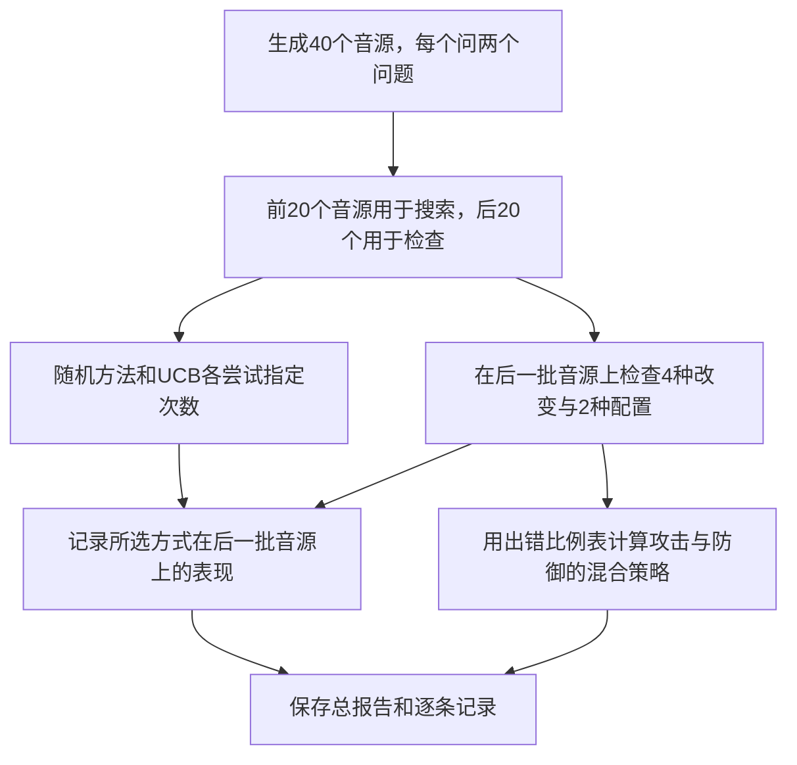

# 第一次使用 AuRel：从打开文件夹到读懂结果

适用：当前仓库的合成演示版本。更新：2026-10-22。

这份指南只介绍已经能运行的功能。后续真实语音计划见 [进度与路线](roadmap.zh.md)。遇到不懂的名词，可以先按步骤做，再回来看解释。

## 1. 你会得到什么

运行后，你会得到两个文本文件：一份总报告，一份逐条记录。它们展示程序能否发现一个事先放进去的错误，以及一个简单修复是否有效。

目前不需要上传音频、不需要 API 密钥、不需要登录模型服务，也不使用显卡。首次安装需要联网下载 Python 依赖；实验本身不调用付费服务。

**当前实验对象是手写规则程序 ToyModel，不是真正的大模型。结果说明测试流程跑通，不能证明某个商用模型有漏洞。**

现在没有网页操作界面，也没有“上传录音”功能；使用方法是在终端里输入命令。终端就是能输入命令、显示运行结果的窗口。

## 2. 用一个例子理解项目

想象一句话分别被平静、开心地说出来。问“说了什么”，答案应该一样；问“什么情绪”，答案应该不同。如果加一点背景噪声后，人仍听得清楚，这两条规则应该继续成立。

为了不下载大模型，当前程序用两段短音调演示同样的逻辑：

| 问题 | 原始音调：先低后高 | 把音频倒过来 | 正确关系 |
|---|---|---|---|
| 音高是上升还是下降？ | rising，上升 | falling，下降 | 答案应改变 |
| 有几段音调？ | two，两段 | two，两段 | 答案应保持 |

程序还会把声音变小、加入噪声。ToyModel 被故意设置为“声音太小就回答 unknown”。另一个版本先把音量调回来，称为 normalize。你会看到测试程序找出变小音量的弱点。

注意：数音调的演示分支直接返回 two，并没有通用的音调计数能力。倒放只适用于此处的音调例子，不能照搬成保持语义的语音变换。

## 3. 准备文件夹和 Python

### Windows：先找到仓库文件夹

如果你已经有本地文件夹，直接打开它。项目拥有者在本次聊天生成的位置是：

```text
C:\Users\pouil\Documents\Codex\2026-10-21\w\outputs\aurel
```

其他读者：登录有权限访问此私有仓库的 GitHub 账号，进入仓库页面，选择 Code → Download ZIP，解压。也可以在已经配置 Git 登录的终端中运行：

```powershell
git clone https://github.com/pouil/AuRel.git
cd AuRel
```

**下载 ZIP 和 git clone 二选一。** 私有仓库显示 404 时，先检查登录账号和仓库访问权限。

在文件资源管理器中打开解压后的文件夹，确认能看到 `README.md`、`pyproject.toml` 和 `aurel` 文件夹。在地址栏输入 `powershell`，按回车。

在这个终端依次运行：

```powershell
Get-Location
Test-Path .\pyproject.toml
python --version
```

第二条应显示 `True`。第三条应显示 Python 版本。建议用 Python 3.11；项目声明支持 3.10 及以上，本机还运行过 3.13，但其他版本未逐一验证。如果没有 Python，先从 [Python 官方下载页](https://www.python.org/downloads/) 安装 Python 3.11，重新打开终端。已安装 Miniconda 的用户也可在其终端中操作，不必再安装一份 Python。

### 建立项目自己的 Python 环境

这个步骤给项目一个独立工具箱，减少影响电脑上其他项目的机会。以下命令都在刚才的仓库目录中运行，一条成功后再运行下一条：

```powershell
python -m venv .venv
.\.venv\Scripts\python.exe -m pip install -e .
```

末尾的 `.` 表示“安装当前文件夹里的项目”，不能省略。安装会下载 NumPy 等依赖。出现错误就先看本指南最后的排错表，不要继续假装安装成功。

后续直接使用 `.venv` 内的 Python，不用运行环境激活脚本，也不用修改 PowerShell 的执行策略。

## 4. 先检查程序，再运行实验

检查程序：

```powershell
.\.venv\Scripts\python.exe -m unittest discover -s tests -v
```

正常结果应包含 `Ran 5 tests` 和 `OK`。这表示五项程序检查通过，不表示真实大模型通过评测。

运行演示：

```powershell
.\.venv\Scripts\python.exe -m aurel.cli --seed 42 --budget 80 --output runs/first-demo
```

命令参数的意思：

| 参数 | 意思 | 第一次是否修改 |
|---|---|---|
| `--seed 42` | 固定随机过程，方便重复同一次实验 | 不修改 |
| `--budget 80` | 每个搜索方法最多尝试 80 次 | 不修改 |
| `--output runs/first-demo` | 将结果写入这个文件夹 | 可以换名字 |

看到类似下面的输出，就说明实验已结束：

```json
{"synthetic_only": true, "report": "runs/first-demo/report.json", "payoff_matrix": [[0.0, 0.0], [1.0, 0.0], [0.0, 0.0], [0.0, 0.0]]}
```

Windows 显示的路径可能使用反斜杠，这是正常的。`synthetic_only: true` 是“仅合成演示”的标记。

不要期待控制台播放音频：当前程序不保存 WAV、不播放声音，只生成计算结果。同一个输出目录再次运行会覆盖其中两个结果文件；想保留旧结果就换目录名。

macOS/Linux 对应命令如下（仍先进入仓库目录）：

```bash
python3 -m venv .venv
.venv/bin/python -m pip install -e .
.venv/bin/python -m unittest discover -s tests -v
.venv/bin/python -m aurel.cli --seed 42 --budget 80 --output runs/first-demo
```

## 5. 打开结果，先只看四项

Windows 可以运行：

```powershell
notepad .\runs\first-demo\report.json
```

也可以在文件资源管理器中打开 `runs/first-demo`。JSON 是带字段名的文本格式；JSONL 则是一行一个记录。文件可以用记事本或代码编辑器打开。

**第一项：`synthetic_only`。** 当前必须是 `true`，防止把演示当真实研究数据。

**第二项：`payoff_matrix`。** 可以把它理解成下面的“出错比例表”：

| 输入改变方式，对应 `arms` 顺序 | 原始程序 raw | 先恢复音量 normalize |
|---|---:|---:|
| identity：不改变 | 0 | 0 |
| gain：把音量降到原来的 35% | 1 | 0 |
| noise：加入固定程度的噪声 | 0 | 0 |
| reverse：倒放音调 | 0 | 0 |

这里 0 是这一组没有出错，1 是全部出错，不是置信度。统计只包含原始输入上答对的样本。演示中所有原始输入均答对。

**如何得出结论：** 原始程序只在小音量条件下失败；恢复音量后该条件通过。这验证了程序能记录“变换导致错误”和“防御修复错误”。错误本来就是人为设置的，所以不能说我们发现了新漏洞。

**第三项：`searches`。** `random` 随机尝试；`ucb` 一边探索，一边多试已发现容易出错的方式。查看 `best_arm_train`（搜索阶段找到的方式）和 `heldout_raw_loss`（换一批音源后该方式的出错比例）。本次两者都找到 gain；这不能证明 UCB 比随机方法更优。

**第四项：`query_counts`。** `--budget 80` 不意味着整个程序只预测 80 次。本次调用数为：

| 部分 | 预测次数 |
|---|---:|
| 两个搜索器，各 80 次 | 160 |
| 测量表格时检查原始音频 | 320 |
| 测量表格时检查变换后音频 | 320 |
| 总计 | 800 |

这是本地规则程序的调用数，不是付费 API 账单。`game` 中的 20000 次数学迭代不调用模型。

## 6. 追查一条失败

下面命令提取前 5 条失败记录，显示成表格：

```powershell
Get-Content .\runs\first-demo\records.jsonl | ForEach-Object { $_ | ConvertFrom-Json } | Where-Object { $_.violation -eq $true } | Select-Object -First 5 id,task,arm,defender,expected,prediction
```

你会看到 `arm=gain`、`defender=raw`，预期答案是 rising/falling/two，实际答案为 unknown。

| 字段 | 读法 |
|---|---|
| `id` | 测试编号，方便找回这一例 |
| `group` | 原始音源编号；同一声音的两个问题共用一个组 |
| `task` | order 问顺序，count 问数量 |
| `arm` | 对声音做了哪种改变 |
| `defender` | 用原始程序还是恢复音量后的程序 |
| `clean_correct` | 没改变声音时是否答对 |
| `expected` | 依据当前任务规则应给出的答案 |
| `prediction` | 实际回答 |
| `violation` | 是否违反预定答案规则；true 表示违反 |

当前记录文件共 320 行；是 40 个留出测试问题 × 4 种变换 × 2 种程序配置，不是 320 个独立原始音源。搜索过程另记在 `report.json` 的 `history` 里。

## 7. 程序内部按什么顺序工作



这里的“搜索训练集”只是用于挑选测试方式，没有训练或微调模型。有限博弈是对已有表格的数学分析；若据此挑选防御，必须另外找未使用过的数据验证，不能继续在同一批数据上宣称泛化效果。

想查看实现时按这个顺序读：

1. `aurel/core.py`：造音调、改变声音、决定答案、手写分类程序。
2. `aurel/cli.py`：把这些步骤串起来，写结果。
3. `aurel/search.py`：随机/UCB 搜索和表格博弈计算。
4. `tests/test_core.py`：检查任务映射、噪声、预算与数学求解是否正常。

## 8. 你现在可以尝试什么

把随机种子改成 7，并用新文件夹：

```powershell
.\.venv\Scripts\python.exe -m aurel.cli --seed 7 --budget 80 --output runs/seed-7
```

把预算改成 20，再用新文件夹：

```powershell
.\.venv\Scripts\python.exe -m aurel.cli --seed 42 --budget 20 --output runs/budget-20
```

比较 `searches` 的 history 长度、尝试方式和 best_arm_train。当前例子很简单，改预算不一定改变最终表格，这是正常现象。不同 NumPy 版本的随机细节可能不同，因此比较时保留版本信息。

**现在不能做：** 把录音放进文件夹就自动测试、使用 `--model` 指定真实模型、用 `--audio` 指定 WAV、运行安全攻击、自动缩减反例。这些参数和流程尚未实现。不要安装 `.[models]` 并期待演示自动变成真实模型。

## 9. 常见问题：看到什么，就做什么

| 现象 | 下一步 |
|---|---|
| `Test-Path` 返回 False | 返回文件资源管理器，进入直接包含 pyproject.toml 的那一层目录 |
| 找不到 python 命令或弹出商店 | 检查 Python 安装；本机有 Miniconda 时可用其终端，再进入仓库目录 |
| 找不到 `.venv\Scripts\python.exe` | 确认创建环境的命令成功，且仍在同一个仓库目录 |
| `No module named numpy` / `aurel` | 使用本指南同一个 `.venv` Python 重新执行安装命令 |
| pip 下载失败 | 检查网络，保留完整错误；不要随意更换不明安装源 |
| 运行到 `--budget` 报错 | budget 必须是大于 0 的整数，例如 80 |
| 看不到结果 | 看控制台 report 路径，再检查当前文件夹；没有成功输出就先处理错误 |
| `cuda_available: False` | 合成演示正常，不需要 CUDA；真实模型阶段另配环境 |
| 结果里没有 wav | 当前设计如此，只有两个文本结果文件 |
| 看到 `unknown` | gain/raw 的演示中这是预期发现的错误，不代表安装坏了 |

向协作者求助时提供：运行的完整命令、`python --version`、最后的报错文本、report.json（若生成）。不要提供密钥。结果默认被 `.gitignore` 排除，不会因为普通 git add 自动进仓库。

## 10. 完成标志与下一步

能看到 5 项测试通过、两个结果文件，并解释表格中 gain/raw 为什么是 1，就完成了当前版本的使用闭环。下一步阅读 [最小验证路线](roadmap.zh.md)：用公开真实语音替换音调，用真正的音频模型替换 ToyModel。

验证范围：本地现有 Python 环境已运行五项测试及本指南的 seed=42、budget=80 演示；初始 GitHub Actions 已验证 Linux/Python 3.11 的安装、测试与演示。本次在受限 Windows 执行环境中新建环境后的联网安装被代理/网络权限阻断，因此尚未完成全新 Windows 环境的安装验证。若看到 ProxyError 后又出现“找不到 setuptools 版本”，先排查网络，不要直接认为 Python 版本不兼容。
